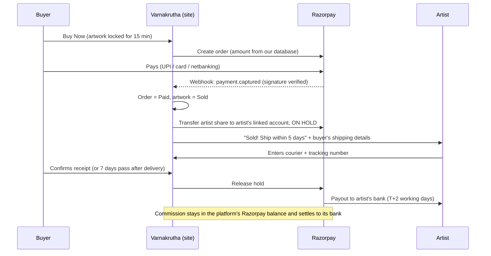
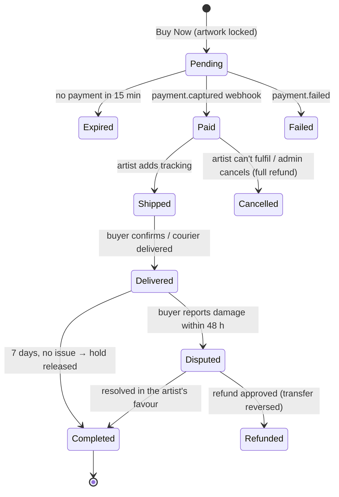

# Payments plan — Varnakrutha

How buyers pay for artworks on varnakrutha.in, how money is split between artists and the platform (commission), and the corner cases. **Section 0 is what's built and how to switch it on**; the rest is the full plan and reasoning.

> **Not tax or legal advice.** Rates below were checked in October 2026 and change often. Confirm the tax treatment with a chartered accountant (CA), and Route eligibility with Razorpay, before going live.

---

## 0. What's built, and how to switch it on

> Coming back to this later? Start with the short checklist in [PAYMENTS-LATER.md](PAYMENTS-LATER.md).

One setting controls everything: **`NEXT_PUBLIC_PAYMENTS_MODE`** (in `.env.local` locally, and in Vercel for the live site; redeploy after changing it).

| Mode | Buyers see | Money |
|---|---|---|
| `off` (default) | Enquire buttons only, as before | — |
| `manual` | **Buy now** (your works) / **Reserve with deposit** (featured artists) → an order page with your UPI ID, amount and reference | Buyers pay your merchant UPI; you confirm each payment in **Admin → Orders** |
| `razorpay` | The same buttons → Razorpay checkout (UPI, cards, netbanking) | Confirmed automatically by Razorpay; featured artists with a linked account get the full-price flow with their share held until you complete the order |

**How each sale works**
- **Your own paintings:** the buyer pays price + shipping. No commission.
- **Featured artist (default):** the buyer pays **your commission as a deposit** to reserve the painting. You introduce them to the artist, and they pay the artist the balance directly. Your commission is collected before they're in touch.
- **Featured artist with a Razorpay linked account** (razorpay mode only): the buyer pays the full price. Route transfers the artist's share **on hold**; **Complete** in Admin → Orders releases it.
- **Record a sale** (Admin → Orders) logs sales made any other way (UPI by message, bank transfer, cash), marks the painting sold and records the commission.

### Switching on manual UPI
1. Run `supabase/migrations/20261029000000_orders_and_payments.sql` in the Supabase SQL Editor (once).
2. Get a merchant UPI ID (PhonePe Business or Google Pay for Business). Optionally save its QR image as `public/payments/upi-qr.png`.
3. Set `NEXT_PUBLIC_PAYMENTS_MODE=manual`, `NEXT_PUBLIC_UPI_ID=…`, `NEXT_PUBLIC_UPI_PAYEE_NAME=Varnakrutha`, (optional) `NEXT_PUBLIC_UPI_QR_IMAGE=/payments/upi-qr.png`, and `COMMISSION_RATE_BPS` (1500 = 15%).
4. Give each artwork a **price** (₹500 or more) and, if needed, a **shipping fee** in its edit form. Artworks without a price stay enquiry-only.
5. Redeploy. Then check **Admin → Orders** at least once every working day:
   - **Awaiting payment:** open your UPI app, find the payment with that reference, and enter its **transaction ID** → **Confirm payment received**. Never confirm from a screenshot.
   - **Paid:** your works: ship and add tracking. Deposits: email the buyer and artist to introduce them.
   - **Complete** once the buyer has the painting (for deposits: once the artist confirms the balance arrived).
   - Unpaid orders release the painting automatically after **48 hours**.

### Switching on Razorpay
1. Same migration as above. Razorpay account activated (business KYC, policy pages; see section 6).
2. Razorpay Dashboard → API Keys → set `RAZORPAY_KEY_ID` and `RAZORPAY_KEY_SECRET` (test keys first).
3. Razorpay Dashboard → Webhooks → add `https://varnakrutha.in/api/razorpay/webhook`, events **order.paid** and **payment.captured**, with a secret. Set the same secret as `RAZORPAY_WEBHOOK_SECRET`.
4. Make sure **automatic capture** is on (Razorpay Dashboard → Payment capture settings).
5. Set `NEXT_PUBLIC_PAYMENTS_MODE=razorpay` and redeploy. Test with Razorpay's test cards and UPI IDs before switching to live keys.
6. **Optional, per featured artist (Route):** create their linked account in Razorpay → Route (their KYC and bank details), then paste the `acc_…` id into **Table Editor → `artists.razorpay_account_id`**. Their works then use the full-price flow. Leave it empty to keep the deposit flow.

### Per-artist settings (Supabase Table Editor → `artists`)
- `commission_rate_bps`: overrides `COMMISSION_RATE_BPS` for that artist (e.g. `1000` = 10% for founding artists).
- `razorpay_account_id`: their Route linked account, as above.

(Mock mode: add `"commissionRateBps"` / `"razorpayAccountId"` to the artist in `.data/db.json`.)

### Corner cases the code handles
- Two buyers on one painting: a database rule allows one live order per artwork; the second sees "someone is buying this".
- Abandoned checkout: holds expire (30 min Razorpay, 48 h manual) and the painting is buyable again.
- Buyer closes the tab after paying: the webhook confirms it anyway; the order page shows the status.
- Duplicate or retried webhooks: confirming twice does nothing; signature and amount are checked.
- Payment arriving after the hold expired: accepted if the painting is still free, **refunded automatically** (Razorpay) if someone else bought it.
- Price or details edited mid-sale: editing, deleting or changing availability is blocked while an order is open; each order keeps the amounts fixed at checkout.
- Cancelling: Razorpay orders are refunded through Razorpay (including any artist transfer). Manual orders require you to refund in your UPI app first and enter its transaction ID.
- Retrying a closed Razorpay window reuses the same order instead of clashing with it.

### Not built yet (do by hand for now)
- **Emails** (receipts, "sold, please ship", payout released): reply by email yourself; buyers' order pages update live.
- **Auto-completing orders after delivery:** press **Complete** yourself.
- **Partial refunds:** use the Razorpay Dashboard (manual: refund in UPI), then note it on the order.
- **GST on commission and TDS** aren't calculated: the CSV export has every amount for your accountant.
- **Artist payout onboarding inside the site:** linked accounts are created in Razorpay's dashboard.
- **International buyers:** India-only addresses for now.

---

## 1. Summary

- **Gateway:** Razorpay, with **Route** for splitting payments between artists and the platform. It supports UPI, cards, netbanking and wallets, settles in INR, and Indian buyers already know it.
- **Model:** Varnakrutha is a **marketplace**: each artist sells their own work, and the platform takes a commission. Sukrutha's own works are sold by the platform directly, with no split.
- **The money never sits with us.** The buyer pays into Razorpay. Razorpay holds the artist's share **on hold** until the buyer has received the painting, then pays it out. The commission stays with the platform.
- **Leakage protection:** buyer and artist contact details are shared only after payment, so the commission is already secured. See also the leakage notes in [ROADMAP.md](ROADMAP.md).
- **Rollout:** start with **Buy Now for Sukrutha's own works** (no split, simplest), then turn on Route for featured artists, then add deposits for commissions and high-value works.

---

## 2. Decisions needed before building

| # | Decision | Options | Suggestion |
|---|---|---|---|
| 1 | **Commission rate** | 10–25% | 15% to start; consider 10% for the first artists |
| 2 | **Who pays the gateway fee** (≈2.36% incl. GST) | Platform absorbs it from the commission / deducted from the artist / added for the buyer | Platform absorbs it: simplest for artists and buyers |
| 3 | **Who ships** | Artist ships / platform arranges courier | Artist ships within 5 working days, with tracking required |
| 4 | **Shipping price** | Included in price / per-artwork shipping fee / free in India | A per-artwork shipping fee the artist sets, passed to the artist in full |
| 5 | **Returns** | No returns on originals / 7-day return if damaged or not as described | Damaged-in-transit or not-as-described only, reported within 48 hours of delivery with photos |
| 6 | **When the artist gets paid** | On dispatch / on delivery / N days after delivery | **7 days after delivery** (or when the buyer confirms receipt, if sooner) |
| 7 | **Business entity & GST** | Sole proprietorship / LLP / company; GST-registered or not | Ask a CA. Razorpay needs a registered business and a current account for Route |
| 8 | **Where you sell** | India only / international | India only at first. International adds export paperwork, customs and higher fees |
| 9 | **Price cap for Buy Now** | None / e.g. ₹1,00,000 | Above the cap, "Reserve with deposit" instead (section 9) |

---

## 3. How the money flows

### Worked example: a featured artist's painting

Assumptions: price **₹20,000**, shipping **₹800**, commission **15%**, platform absorbs the gateway fee, artist **not** GST-registered, and the platform **is** GST-registered. Every line marked † depends on a CA's advice.

| Line | Amount (₹) | Notes |
|---|---:|---|
| Buyer pays | **20,800.00** | Price + shipping |
| Gateway fee (2% + 18% GST on the fee) | −490.88 | Razorpay deducts it; borne by the platform |
| Commission (15% of the price, not of shipping) | 3,000.00 | Platform's income |
| GST on commission (18%) † | 540.00 | Platform invoices the artist; deducted from their payout |
| TDS u/s 194-O (0.1% of gross) † | 20.00 | Waived for individual artists with ≤₹5 lakh/year of sales on the platform who give their PAN |
| **Artist payout** | **17,240.00** | 20,800 − 3,000 − 540 − 20 |
| **Platform keeps** | **3,069.12** | 3,000 + 540 + 20 − 490.88; the 540 GST and 20 TDS are then paid to the government |
| **Platform's real income** | **2,509.12** | Commission minus the gateway fee |

**Rules for the calculation**
- Store every amount in **paise, as whole numbers**. Never use decimals for money.
- **Commission is on the artwork price only.** Shipping passes to the artist in full.
- **Round commission and taxes to the nearest paisa (half up).** The artist's payout is whatever is left, so the total always adds up exactly.
- **Save the breakdown on the order when it's created** (rate, fee, taxes). Changing the commission rate later must never change past orders.

### Sukrutha's own work
There's no split. The platform is the seller: the full amount minus the gateway fee settles to the platform's bank account. If the platform is GST-registered, charge GST on the painting (5% under HSN 9701 for hand paintings, from 22 Sep 2025 †).

---

## 4. What needs to be built

### 4.1 Database (Supabase)

| Table / column | Purpose |
|---|---|
| `artworks.buy_now_enabled`, `shipping_fee`, `ships_within_days`, `framing`, `reserved_until` | What can be bought, for how much, and the 15-minute checkout lock |
| `artist_payout_accounts` | `artist_id`, Razorpay linked account id, KYC status (`pending` / `activated` / `rejected`), bank last 4 digits, PAN status |
| `orders` | Buyer name, email, phone, shipping address; artwork and artist; **amount breakdown in paise** (price, shipping, commission rate and amount, GST on commission, TDS, gateway fee, artist share); Razorpay order, payment and transfer ids; status; courier and tracking; timestamps for every step |
| `order_events` | Append-only history: every status change, webhook and admin action, with who did it and when. Used for disputes and audits |
| `refunds` | Amount, reason, Razorpay refund id, whether the artist's transfer was reversed |
| `commission_ledger` | One row per order: commission, GST, TDS, fee, net. Feeds the monthly statements and the CA's filings |

Row-level security: buyers have no login, so they read orders only through a signed link. Artists see only their own orders, **without the buyer's phone or email until the order is Paid**. Admins see everything.

### 4.2 Order statuses

### 4.3 Server pieces
- **Create order (server action):** re-reads the price **from the database**, checks the artwork is available and the artist's payout account is activated, locks the artwork for 15 minutes, saves the breakdown, and creates the Razorpay order.
- **Checkout:** Razorpay Checkout on the artwork page. The buyer enters name, email, phone and address first.
- **Webhook (`/api/razorpay/webhook`):** verifies the signature with `RAZORPAY_WEBHOOK_SECRET`, handles each event **once** (by event id), and is the **only** thing that can mark an order Paid. The browser's "success" callback only shows a "confirming…" screen.
- **Transfers:** after capture, create the transfer to the artist's linked account with `on_hold: true`, and release it at Completed.
- **Refunds:** the full or partial refund API, with transfer reversal when the artist's share must come back.
- **Daily job (Vercel Cron):** expire stale locks; auto-complete orders 7 days after delivery; nudge artists who haven't shipped by day 4; flag orders not shipped by day 6.
- **Emails:** buyer receipt, artist "Sold, please ship", shipped and delivered notices, payout released, and refund confirmation.
- **Admin screens:** Orders (filter by status), order detail with timeline, refund and cancel buttons, a commission report (monthly, with CSV export), and artist payout account status.
- **Artist screens:** "My orders", enter tracking, payout status, and a monthly statement.

### 4.4 Settings (Vercel)
`RAZORPAY_KEY_ID` (public, used by Checkout), `RAZORPAY_KEY_SECRET` (server only), `RAZORPAY_WEBHOOK_SECRET` (server only), and `COMMISSION_RATE_BPS` (e.g. `1500` = 15%; per-artist overrides in the database). Use separate **test** and **live** keys, and never mix them.

---

## 5. Corner cases

### Stock and checkout
| Case | Handling |
|---|---|
| **Two buyers click Buy Now on the same painting** | Lock the artwork in the database inside a transaction (`reserved_until`, plus a unique "one open order per artwork" constraint). The second buyer sees "Someone is checking out this painting; try again in 15 minutes" |
| **Lock expires while the buyer is still paying** (slow UPI) | Keep the Razorpay order valid for longer than the lock. If payment arrives after someone else has bought it, refund it automatically in full and email an apology |
| **Price edited during checkout** | The order uses the price saved when it was created. The artist can't edit the price, or delete the artwork, while an order is open |
| **Artwork marked sold offline while listed** | The artist sets it Sold in the admin, which disables Buy Now. If an order already exists, cancel it with a full refund, and flag it, because it may be leakage |
| **Artist suspended or removed with open orders** | Block new orders. Ask about open ones: either the artist fulfils them and the hold is released after delivery, or cancel and refund. Never delete an artist with open orders |
| **Artist has no activated payout account** | Buy Now is hidden for their works; enquiry only. Show the artist a "Complete payout setup to sell" banner |
| **Very cheap or ₹0 price** | Minimum price, e.g. ₹500, so fees don't exceed the commission |

### Payment
| Case | Handling |
|---|---|
| **Payment fails** | Order → Failed, lock released, buyer can retry |
| **UPI pending** (authorised later) | Keep the order Pending; the webhook decides. Show "We'll email you once the payment is confirmed" |
| **Buyer closes the tab after paying** | The webhook still marks it Paid, and the receipt email goes out. The receipt never depends on the browser |
| **Webhook arrives twice or out of order** | Store the event ids; ignore repeats; status changes only move forward |
| **Webhook never arrives** | The daily job fetches each Pending order's payments from Razorpay and reconciles them |
| **Someone tampers with the amount in the browser** | The amount comes only from our database, and the webhook checks the captured amount against the order |
| **Payment captured, but the transfer fails** (Route retries up to 3 days) | Log it and alert the admin. The order stays Paid; the artist's share is retried or sent manually |
| **Test payment in live mode, or the other way round** | Separate keys per environment; the webhook rejects events whose mode doesn't match |
| **High-value card fraud** | 3-D Secure is on by default. Add a manual review for orders above a threshold, or for a first order shipping to a different state from the card's |

### Shipping and delivery
| Case | Handling |
|---|---|
| **Artist doesn't ship in time** | Reminder on day 4, admin flag on day 6, and the buyer may cancel with a full refund after day 7 |
| **Lost in transit** | Full refund to the buyer. Who bears the loss: the artist ships insured (state this in the artist terms), and the claim is between artist and courier |
| **Damaged in transit** | Buyer reports within 48 hours with photos, Disputed → refund and return, or partial refund if the buyer keeps it. Transfer reversed as needed |
| **Wrong address entered by the buyer** | Artist contacts the buyer via the order page; re-shipping cost is borne by the buyer |
| **Buyer never confirms receipt** | Auto-complete 7 days after the courier marks it delivered. If there's no tracking update, admin checks before releasing |
| **International buyer** | Phase 1: India-only addresses. International needs export invoices, customs, insurance, and Razorpay international activation (≈3% + GST) |

### Refunds, disputes and chargebacks
| Case | Handling |
|---|---|
| **Cancelled before shipping** | Full refund. The artist's transfer is still on hold, so reverse it; the commission is reversed too. The gateway fee isn't returned by Razorpay; the platform bears it |
| **Refund after the hold was released** | Reverse the transfer, which pulls the money back from the artist's linked account balance. If that balance is empty, deduct it from their next payout; the artist terms must allow this |
| **Partial refund** (keeps the painting at a discount) | Split the refund proportionally between artist share and commission, and record both in the ledger |
| **Chargeback** (buyer disputes with their bank) | Respond in Razorpay's dashboard with proof (order, tracking, delivery, photos). Holding payouts for 7 days after delivery is what gives you time. If it's lost, recover the artist's share as with refunds |
| **Not as described** | Return within 48 hours, unused, original packing; refund on receipt by the artist. Return shipping is paid by the artist if the listing was inaccurate, otherwise by the buyer |

### Commission
| Case | Handling |
|---|---|
| **Rate changes** | Applies only to new orders; past orders keep their saved rate |
| **Special rates** | Per-artist rate column (e.g. 10% for founding artists, 0% for Sukrutha) |
| **Discounts or coupons** (later) | Commission on the price actually paid; decide who funds the discount and record it |
| **Commissioned paintings and deposits** | The deposit is an order too. The commission comes from the deposit first (section 9) |
| **Sale arranged outside the site** (leakage) | Not technically preventable. Covered by the artist terms (no-circumvention, 12 months) and the "sold with no order" flag in the admin |

### Taxes and records †
| Case | Handling |
|---|---|
| **GST on commission** | 18% on the platform's commission invoice to the artist, if the platform is GST-registered |
| **GST on the painting** | Only if the artist (or, for her own works, the platform) is GST-registered: 5% under HSN 9701 from 22 Sep 2025. Many individual artists are below the threshold. Confirm the rules for selling through a marketplace |
| **TCS (GST s.52)** | E-commerce operators may have to collect TCS on GST-registered sellers' sales; CA to confirm the rate and applicability |
| **TDS (Income Tax s.194-O)** | 0.1% of gross sales (from 1 Oct 2024). Not required for individual artists with ≤₹5 lakh/year of sales via the platform who give their PAN; **5% if there's no PAN** (s.206AA). Collect PAN during payout setup |
| **Invoices** | Buyer gets a receipt/invoice from the seller (artist, or platform for Sukrutha's works). Artist gets a monthly commission invoice and statement |
| **Records** | Keep orders and the ledger for at least 8 years (books-of-account rules). Customer data follows the Privacy Policy, which must be updated to mention addresses and payments |

---

## 6. Pages and agreements needed

Razorpay usually checks for these during activation:
- **Terms of Sale:** who the seller is (the artist), what the platform does, and price and payment terms.
- **Shipping Policy:** dispatch time, couriers, insurance, India-only at first.
- **Cancellation & Refund Policy:** the rules from section 5, in plain words.
- **Contact details:** a business name, address and email shown on the site.
- **Artist Agreement**, accepted when an artist sets up payouts: commission rate, payout timing, the 7-day hold, refund and chargeback recovery, shipping and insurance duties, the no-circumvention clause (12 months), and the right to suspend.
- **Privacy Policy update:** addresses, phone numbers and payment records are now stored; payments are processed by Razorpay.

---

## 7. Rollout plan

| Phase | What | Needs |
|---|---|---|
| **0. Prerequisites** | Business registration and current account; Razorpay account and KYC; the policy pages above; CA advice on GST and TDS | Done by you; about 1–3 weeks for KYC |
| **1. Buy Now, Sukrutha's works** | Orders, checkout, webhook, statuses, emails, admin Orders screen. No split, so no Route needed | Razorpay standard activation |
| **2. Featured artists (Route)** | Artist payout setup (linked accounts, KYC, PAN), transfers on hold, release, reversals, commission ledger and statements, artist "My orders" | Route activated on your account. Since the RBI's Payment Aggregator Directions (Sep 2025), Route access is compliance-gated; ask Razorpay what they need from a marketplace |
| **3. Deposits** | "Reserve with deposit" for high-value works and commissioned paintings | Phase 2 |
| **4. Extras** | International shipping, prints, coupons, subscriptions (see [ROADMAP.md](ROADMAP.md)) | Demand |

---

## 8. Testing checklist (Razorpay test mode)
- [ ] Successful card, UPI and netbanking payments mark the order Paid only via the webhook.
- [ ] Failed payment and abandoned checkout: the lock expires and the artwork is buyable again.
- [ ] Two browsers on one painting: only one order is created.
- [ ] A duplicate webhook is ignored; a wrong signature is rejected.
- [ ] A late payment after the lock expired and the painting was bought by someone else is refunded automatically.
- [ ] Transfer is created on hold, then released at Completed; the artist's payout appears.
- [ ] Refund before shipping, after shipping, partial, and after release (reversal).
- [ ] Commission breakdown matches the worked example to the paisa.
- [ ] Artist sees the buyer's address only after Paid; another artist can't see the order at all.

---

## 9. Deposits ("Reserve with deposit")
For works above the Buy Now cap, and for commissioned paintings:
1. The buyer pays a deposit (e.g. 20%) through the same checkout. Order type `deposit`; the artwork is Reserved for an agreed period.
2. **The commission is taken from the deposit first.** If the rest is paid outside the site, the platform has already been paid. If it's paid through the site, it's a normal order for the balance.
3. Contact details are shared after the deposit is paid.
4. Corner cases: the buyer doesn't pay the balance (deposit kept or partly refunded, per the terms); the artist backs out (full refund of the deposit); the commissioned work isn't what was agreed (mediation by admin; terms say what's refundable).

---

## 10. Open questions for you
1. Commission rate, and any founding-artist rate?
2. Will Varnakrutha be a registered business (and GST-registered) before launch?
3. India-only for now?
4. Buy Now cap amount?
5. Return window: 48 hours for damage only, or 7 days?

Once these are answered, Phase 1 (Sukrutha's own works) can be built without waiting for Route.

### Sources checked (October 2026)
- [Razorpay Route docs](https://razorpay.com/docs/payments/route/), [integration guide](https://razorpay.com/docs/payments/route/integration-guide), [Route FAQs](https://razorpay.com/docs/payments/route/faqs.md)
- [Razorpay pricing explained](https://razorpay.com/blog/razorpay-payment-gateway-pricing-explained/)
- [TDS s.194-O rate cut to 0.1% (taxguru)](https://taxguru.in/income-tax/section-194-o-amendment-lower-tds-rate-e-commerce-payments.html), [ClearTax on s.194-O](https://cleartax.in/s/section-194o)
- [GST on HSN 9701 at 5% from 22 Sep 2025 (taxguru, notification text)](https://taxguru.in/?p=987622)
- [RBI Payment Aggregator Directions 2025 (AZB & Partners)](https://www.azbpartners.com/bank/rbi-issues-consolidated-reserve-bank-of-india-regulation-of-payment-aggregators-directions-2025/), [Cyril Amarchand client alert](https://www.cyrilshroff.com/wp-content/uploads/2025/10/Client-Alert-RBI-Introduces-Consolidated-Framework-for-Payment-Aggregators-3.pdf)
